# Campionatore IR

**Telecomando universale a infrarossi che funziona senza app né cloud.**

Un ESP32-S3 registra il segnale grezzo di qualsiasi telecomando IR e lo ritrasmette con la stessa portante.
I telecomandi si creano e si usano da una web app installabile (PWA) servita direttamente dal dispositivo:
basta un browser sulla rete di casa, oppure sulla rete Wi-Fi che il dispositivo crea da solo.

> *In English: a universal infrared remote built on an ESP32-S3. It captures raw IR signals from any remote,
> measures the carrier frequency and replays them through the RMT peripheral. It is controlled by a PWA served
> by the device itself, with no cloud and no app. The repository contains the firmware, the web app and the
> KiCad project of a 2-layer PCB with production files.*

<p align="center">
  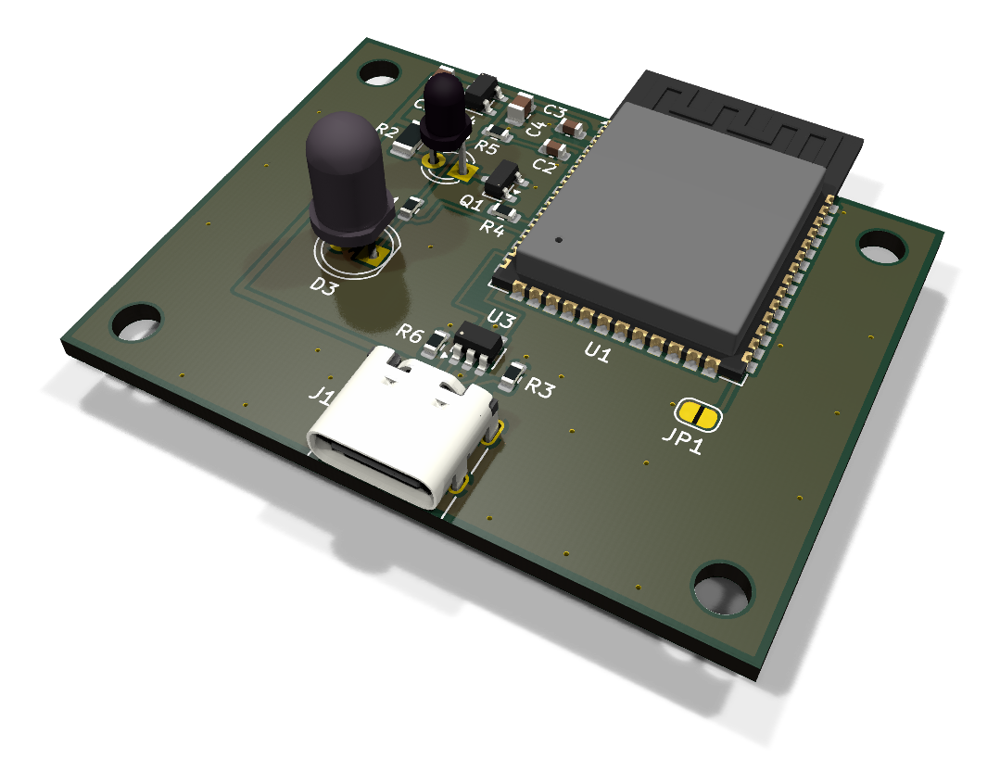
</p>

- **Campionamento RAW**: registra le durate di ogni impulso e misura la portante (38 kHz, 36 kHz per RC5,
  40 kHz per Sony...), quindi funziona anche con protocolli che una libreria non riconosce, condizionatori compresi.
- **Riproduzione in hardware**: la periferica RMT genera impulsi e portante, senza tempi morti dovuti al software.
- **Web app sul dispositivo**: layout pronti per TV e condizionatore, telecomandi personalizzati, backup e ripristino.
- **Nessuna dipendenza esterna**: si collega alla rete di casa oppure crea un proprio Access Point.
- **PCB pronto per la produzione**: due layer, 48,7 × 37,1 mm, alimentazione e programmazione da USB-C.

## Indice

- [La web app](#la-web-app)
- [Hardware](#hardware)
- [Struttura del repository](#struttura-del-repository)
- [Compilazione e caricamento](#compilazione-e-caricamento)
- [Uso](#uso)
- [API REST](#api-rest)
- [Come funziona](#come-funziona)
- [Produzione del PCB](#produzione-del-pcb)
- [Risoluzione dei problemi](#risoluzione-dei-problemi)
- [Licenza](#licenza)

## La web app

<p align="center">
  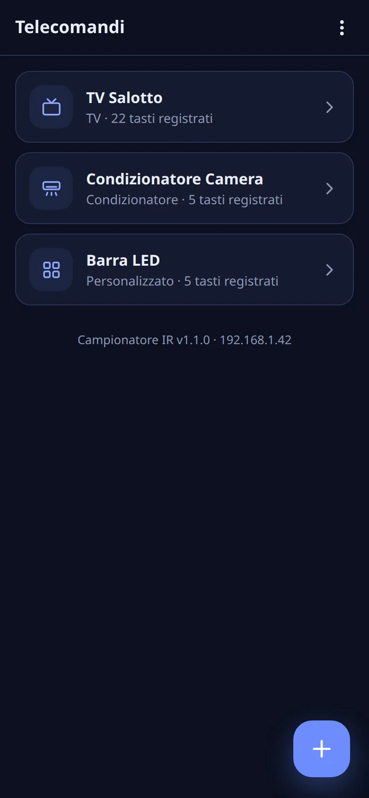
  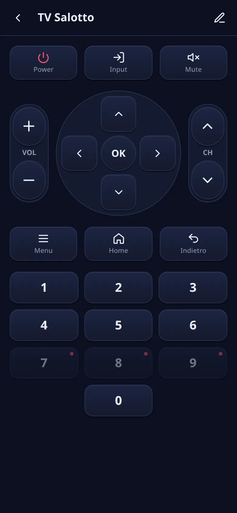
  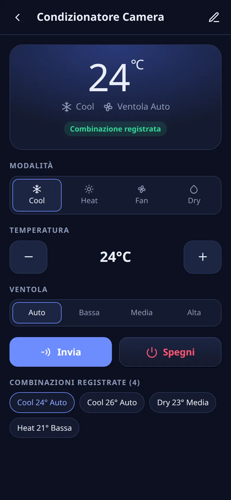
</p>
<p align="center">
  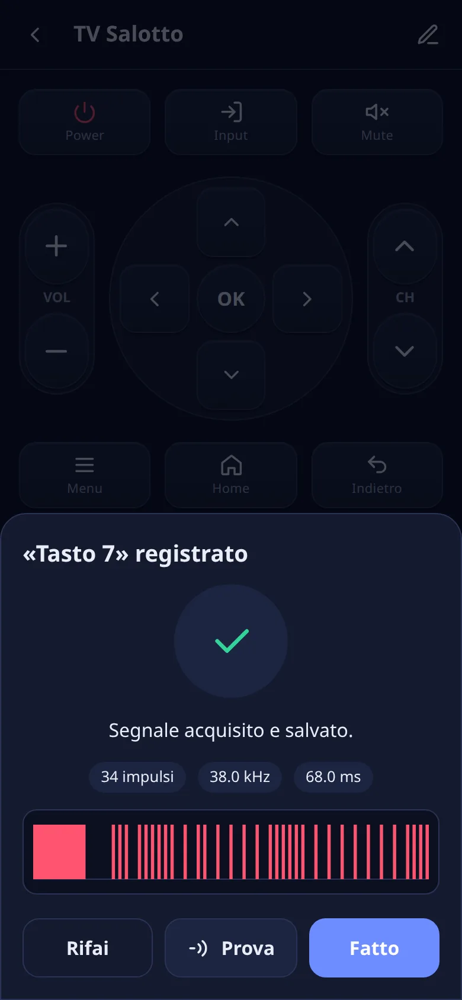
  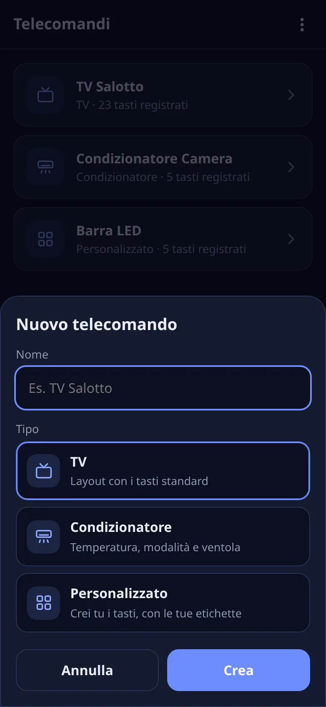
  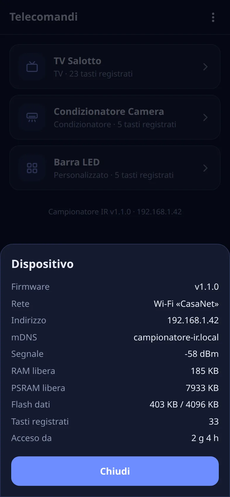
</p>

Da sinistra: i telecomandi salvati, un telecomando TV, un condizionatore, la registrazione di un tasto,
la creazione di un telecomando e lo stato del dispositivo.

## Hardware

### Prototipo

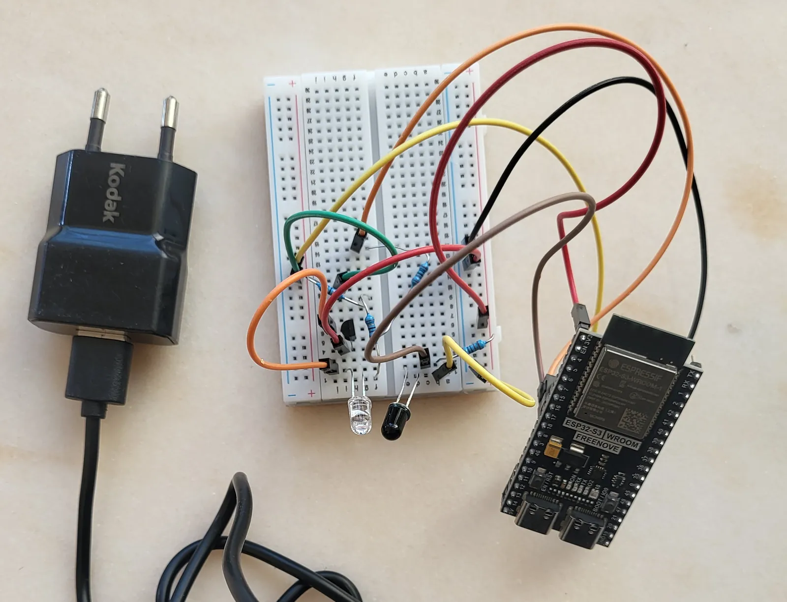

Il primo circuito è montato su breadboard attorno a una scheda di sviluppo ESP32-S3:

| Funzione | GPIO | Circuito |
| --- | --- | --- |
| Ricezione | **18** | Catodo del fotodiodo + pull-up 10 kΩ verso 3,3 V, anodo a GND |
| Trasmissione | **17** | 1 kΩ → base di un 2N2222A; LED IR + 2 × 10 Ω dal 5 V al collettore |

### PCB

<p align="center">
  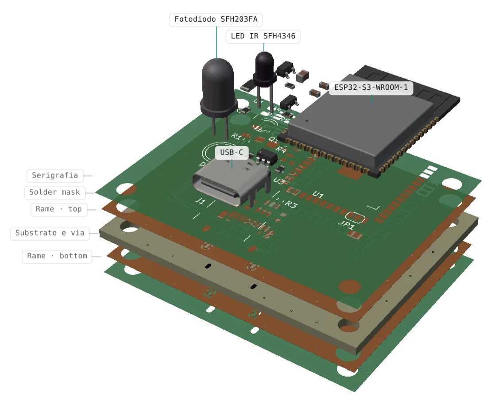
</p>

Il PCB, progettato in KiCad 9, riprende gli stessi pin del prototipo:

| Rif. | Componente | Ruolo |
| --- | --- | --- |
| U1 | ESP32-S3-WROOM-1 | Microcontrollore con Wi-Fi e antenna integrata (sporge oltre il bordo, lontano dal rame) |
| J1 | USB-C (USB 2.0) | Alimentazione 5 V e programmazione tramite la USB nativa dell'ESP32-S3 |
| U3 | USBLC6-2SC6 | Protezione ESD sulle linee dati USB |
| U4 | AP2112K-3.3 | Regolatore lineare 5 V → 3,3 V |
| D2 | SFH4346 | LED IR da 3 mm, pilotato da Q1 (BC818) con 470 Ω sulla base (GPIO 17) e 20 Ω in serie al LED |
| D3 | SFH203FA | Fotodiodo IR con filtro per la luce visibile, pull-up 10 kΩ (GPIO 18) |
| JP1 | Ponticello a saldare | Collega IO0 a GND per forzare la modalità di download, se serve |

Lo schema completo è in [`hardware/campionatore-ir-schema.pdf`](hardware/campionatore-ir-schema.pdf).

<p align="center">
  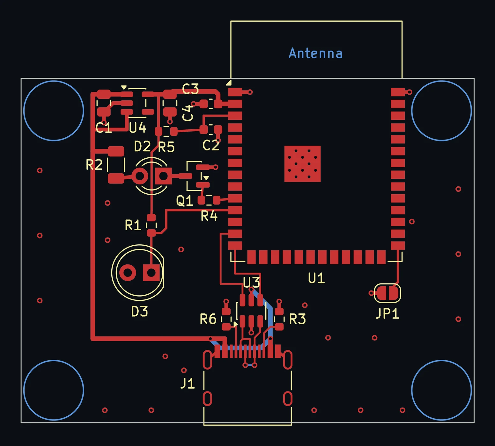
  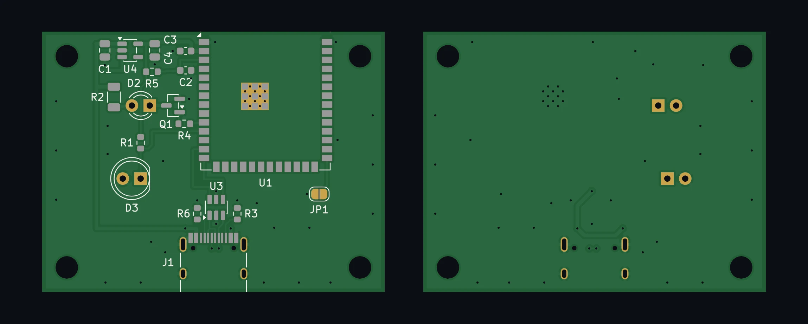
</p>

## Struttura del repository

```
├── firmware/                     progetto PlatformIO
│   ├── platformio.ini
│   ├── include/config.h          Wi-Fi, pin, tempi di campionamento
│   ├── src/
│   │   ├── main.cpp              avvio, Wi-Fi, mDNS, web server
│   │   ├── ir_engine.*           task IR: campionamento, trasmissione RMT, salvataggi
│   │   ├── ir_demod.h            demodulatore software (mark/space + misura della portante)
│   │   ├── json_scan.h           lettore JSON in streaming (backup e vecchi database)
│   │   ├── storage.*             metadati in RAM, segnali su LittleFS
│   │   └── web_api.*             API REST e file statici
│   └── data/www/                 web app: index.html, app.js, style.css, sw.js, manifest, icone
├── hardware/                     progetto KiCad 9
│   ├── ESP32custom.kicad_pro / .kicad_sch / .kicad_pcb
│   ├── campionatore-ir-schema.pdf
│   ├── 3d/campionatore-ir.step   modello 3D della scheda montata
│   └── produzione/               Gerber e forature, distinta componenti (BOM), posizioni (CPL)
└── docs/img/                     immagini di questo README
```

## Compilazione e caricamento

Serve [PlatformIO](https://platformio.org/) (estensione di VS Code oppure riga di comando).

**1. Configura la rete.** In `firmware/include/config.h` inserisci la rete di casa:

```c
#define WIFI_SSID "NomeRete"
#define WIFI_PASSWORD "password"
```

Se `WIFI_SSID` resta vuoto, o la connessione non riesce entro 20 s, il dispositivo crea l'Access Point
**`Campionatore-IR`** (password `irremote123`, da cambiare in `AP_PASSWORD`) e la web app è su
**http://192.168.4.1**.

**2. Controlla la flash.** `platformio.ini` è impostato per moduli da 8 MB; le righe commentate spiegano come
passare a 4 o 16 MB e come attivare la PSRAM.

**3. Carica firmware e web app.**

```bash
cd firmware
pio run -t upload       # firmware
pio run -t uploadfs     # web app nel filesystem LittleFS
pio device monitor      # log: indirizzo IP, segnali acquisiti, invii
```

Sul PCB la porta seriale passa dalla USB nativa: per vedere i log decommenta `-DARDUINO_USB_CDC_ON_BOOT=1`
in `platformio.ini`. Se la scheda non entra da sola in modalità download, chiudi JP1 con una goccia di stagno,
ricollega la USB e riaprilo dopo il caricamento.

**4. Apri la web app** all'indirizzo stampato sul monitor seriale, oppure su `http://campionatore-ir.local`.
Per averla a schermo intero: menu del browser → *Aggiungi a schermata Home*.

> `uploadfs` riscrive tutta la partizione LittleFS, **compresi i telecomandi salvati**. Prima di aggiornare la
> web app esporta un backup (⋮ → *Esporta backup*) e reimportalo dopo (⋮ → *Importa backup*).

## Uso

- **Nuovo telecomando** (pulsante +): scegli un nome e il tipo.
  - **TV**: Power, Input, Mute, volume, canali, frecce e OK, Menu, Home, Indietro, tastierino numerico.
  - **Condizionatore**: modalità (Cool, Heat, Fan, Dry), temperatura (16–30 °C) e ventola. I condizionatori
    inviano tutto lo stato in ogni segnale, quindi ogni combinazione si registra una volta sola.
  - **Personalizzato**: i tasti che vuoi, ognuno con la sua etichetta.
- **Registrare un tasto**: tocca un tasto tratteggiato e punta il telecomando originale verso il fotodiodo,
  a pochi centimetri.
- **Usare un tasto**: un tocco trasmette; volume, canali e frecce si ripetono tenendoli premuti.
- **✎ Modifica**: un tocco registra di nuovo il tasto, × lo elimina, in fondo c'è *Elimina telecomando*.

## API REST

La web app usa le stesse API disponibili a qualsiasi client sulla rete. I parametri vanno come form
(`application/x-www-form-urlencoded`) nelle POST e come query string in GET e DELETE. Le risposte sono JSON;
in caso di errore `{"ok": false, "error": "…"}`.

| Metodo | Endpoint | Parametri | Funzione |
| --- | --- | --- | --- |
| GET | `/api/remotes` | `lite=1` facoltativo | Backup completo (metadati + impulsi); con `lite=1` solo i metadati |
| POST | `/api/remotes` | `name`, `type` (`tv` / `ac` / `custom`) | Crea un telecomando |
| POST | `/api/learn` | `remote`, `button`, `label`, `gap` (ms, facoltativo) | Avvia la cattura di un tasto |
| GET | `/api/learn` | | Stato: `waiting`, `capturing`, `done`, `timeout`, `cancelled`, `error` |
| DELETE | `/api/learn` | | Annulla la cattura |
| POST | `/api/send` | `remote`, `button` | Trasmette il segnale |
| DELETE | `/api/delete` | `remote`, `button` facoltativo | Elimina un tasto o l'intero telecomando |
| POST | `/api/import` | corpo = JSON del backup | Ripristina un backup |
| GET | `/api/info` | | Versione, rete, memoria, spazio sulla flash, tasti registrati |

Un giro completo da terminale: creare un telecomando, registrare il tasto Power e trasmetterlo.

```bash
# crea il telecomando: la risposta è {"ok":true,"remote":{"id":"3fa2c1d0",…}}
curl -X POST http://campionatore-ir.local/api/remotes -d "name=TV Sala&type=tv"

# avvia la cattura, poi premi Power sul telecomando originale entro 15 s
curl -X POST http://campionatore-ir.local/api/learn -d "remote=3fa2c1d0&button=power&label=Power"
curl http://campionatore-ir.local/api/learn          # ripeti finché lo stato è "done"

# trasmetti
curl -X POST http://campionatore-ir.local/api/send -d "remote=3fa2c1d0&button=power"

# elimina il tasto
curl -X DELETE "http://campionatore-ir.local/api/delete?remote=3fa2c1d0&button=power"
```

Backup e ripristino:

```bash
curl http://campionatore-ir.local/api/remotes -o backup.json
curl -X POST http://campionatore-ir.local/api/import -H "Content-Type: application/json" --data-binary @backup.json
```

Il backup viene prodotto e riletto in streaming, quindi la sua dimensione non è limitata dalla RAM:

```json
{"version":2,
 "remotes":[{"id":"3fa2c1d0","name":"TV Sala","type":"tv",
             "buttons":[{"id":"power","label":"Power","freq":38000,"len":67}]}],
 "signals":[{"r":"3fa2c1d0","b":"power","freq":38000,"raw":[4500,4450,560,…]}]}
```

## Come funziona

### Campionamento

Il fotodiodo non demodula il segnale: durante ogni impulso il pin 18 oscilla alla frequenza della portante.
Il firmware:

1. attende il primo fronte di discesa con un interrupt;
2. campiona il pin con `micros()` in un task ad alta priorità sul core 1;
3. unisce gli impulsi di portante distanti meno di 150 µs in un unico *mark* e misura la portante con la moda
   dell'istogramma dei periodi; se la distribuzione è ambigua scarta la misura e usa 38 kHz;
4. chiude il pacchetto dopo 15 ms di silenzio (50 ms per i condizionatori, che spesso inviano più pacchetti);
5. salva le durate in microsecondi: `[mark, space, mark, …, mark]`.

Se il primo fronte arriva prima che la linea sia rimasta libera per un intero intervallo, la cattura viene
scartata: il telecomando era già in trasmissione e il pacchetto sarebbe incompleto.

In trasmissione la periferica **RMT** genera le durate registrate e la portante misurata, con duty cycle del 33%.
Il demodulatore funziona anche con un ricevitore integrato a tre pin (TSOP38238 e simili) sul GPIO 18; in quel
caso si usa la portante predefinita di 38 kHz.

### Memorizzazione

```
/db.json                        metadati: nomi, etichette, portanti, lunghezze
/sig/<telecomando>/<tasto>.bin  impulsi di un singolo segnale (uint16, µs)
```

In RAM restano solo i metadati, poche decine di byte per tasto; gli impulsi stanno sulla flash e si leggono al
momento dell'invio (14–80 ms). Con 133 tasti la RAM occupata è di circa 20 KB, contro i circa 170 KB della prima
versione, che teneva tutto in un unico JSON in memoria. Un database della versione precedente
(`/remotes.json`) viene convertito automaticamente al primo avvio.

Tempi, soglie e limiti sono tutti in `firmware/include/config.h`.

## Produzione del PCB

In `hardware/produzione/`:

- `campionatore-ir-gerber.zip`: Gerber e forature, da caricare così com'è su JLCPCB o servizi simili;
- `campionatore-ir-bom.csv`: distinta componenti raggruppata per valore e footprint;
- `campionatore-ir-cpl.csv`: posizioni e rotazioni dei componenti per il montaggio.

Controlla le rotazioni nell'anteprima del servizio di montaggio: le convenzioni dei footprint cambiano da un
fornitore all'altro. D2 e D3 sono componenti a foro passante.

Un preventivo reale di JLCPCB, con componenti, montaggio, test e spedizione inclusi: **15,41 €** a scheda su 5
pezzi, **3,43 €** a scheda su 600.

I file di produzione si rigenerano dal progetto con `kicad-cli`:

```bash
cd hardware
kicad-cli pcb export gerbers -o gerber/ --layers F.Cu,B.Cu,F.Paste,B.Paste,F.Silkscreen,B.Silkscreen,F.Mask,B.Mask,Edge.Cuts ESP32custom.kicad_pcb
kicad-cli pcb export drill -o gerber/ --format excellon --excellon-separate-th ESP32custom.kicad_pcb
kicad-cli pcb export pos -o campionatore-ir-cpl.csv --format csv --units mm --side both ESP32custom.kicad_pcb
kicad-cli sch export bom -o campionatore-ir-bom.csv ESP32custom.kicad_sch
```

## Risoluzione dei problemi

- **`campionatore-ir.local` non risponde**: i nomi `.local` (mDNS) viaggiano in multicast sul Wi-Fi e qualche
  risposta va persa. Usa l'indirizzo IP (meglio se riservato nel router) oppure il nome che il router registra
  nel proprio DNS, per esempio `http://campionatore-ir.station/`.
- **Il segnale non viene ricevuto**: con un fotodiodo e 10 kΩ di pull-up la sensibilità è bassa, quindi il
  telecomando va tenuto a 1–5 cm. Per più portata porta il pull-up a 47–100 kΩ oppure usa un ricevitore TSOP.
- **Un condizionatore non risponde**: registra di nuovo la combinazione tenendo il telecomando fermo e vicino.
  Il monitor seriale stampa le durate acquisite (`[IR] raw: …`), utili per confrontare due catture.
- **Installazione come app**: i browser abilitano Service Worker e installazione solo su HTTPS. Su `http://<ip>`
  la cache funziona comunque grazie agli ETag; su iPhone l'app aggiunta alla Home si apre a schermo intero anche
  via HTTP.

## Licenza

[MIT](LICENSE)

## Test push

Verifica push con account **DeepDruido** — 12/11/2026.
